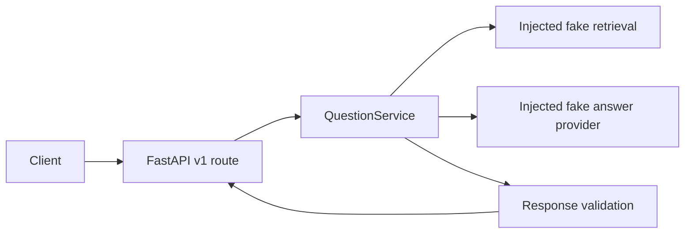

# Backend & AI Handoff

> **Status: CURRENT — Feature 007 accepted; P4-09 and P4-10 remain pending.**
>
> This handoff records repository evidence available on branch
> `007-public-retrieval-facade` at commit
> `6c7748147fb0c3a47d26f8a0deb4dbdd58764a4f`. It does not grant acceptance,
> replace review, or authorize live AI providers or database work.

## 1. Executive Summary

Person 3's accepted Feature 011 work provides a deterministic, fake-only
Backend & AI foundation for `POST /api/v1/questions`. It deliberately does
not use a real corpus, database retrieval, Gemini, or another live provider.

Person 3 also implemented the delegated T007 public retrieval-facade scope:
versioned public DTOs and errors, an import-safe `RetrievalService`, a private
core composition bridge, response/provenance mapping, and offline conformance
coverage. T007-B, T007-C, and T007-D are accepted and committed. T007-E is
owner-confirmed accepted after Person 2 review and an owner-reported native
Windows pass whose terminal evidence was not retained. Feature 007 is
owner-confirmed accepted; P4-09 and P4-10 remain future work.

The confirmed next Backend & AI backlog item is **P4-09 — shared retrieval
service integration**. It is a future adapter/composition task between the
Feature 011 question service and the public retrieval facade; it has not been
implemented by successful T007 testing.

## 2. Person 3 Ownership and Scope

| Area | Person 3 responsibility established by repository evidence | Boundary |
| --- | --- | --- |
| Feature 011 | Fake Backend & AI API foundation, contracts, injected fakes, validation, HTTP mapping, and verification evidence. | Accepted only for its fake-only, offline scope. |
| T007 public facade | Delegated implementation of the public retrieval DTO/error/service boundary and its tests. | Does not transfer ownership of the retrieval core, database schema, corpus ingestion, SQL, or ranking algorithms. |
| Feature 005 / 006 | Dependency consumer. | Feature 005 PostgreSQL/pgvector foundation and Feature 006 snapshot ingestion are Person 2-owned infrastructure. |
| Future Phase 4 | P4-09 and later Backend & AI backlog work in [PROJECT_TODO.md](../../PROJECT_TODO.md). | Requires its own approved specification, plan, tests, review, and acceptance. |

Repository ownership is stated in [AGENTS.md](../../AGENTS.md): Person 1 owns
data processing and embeddings; Person 2 owns database and retrieval; Person
3 owns Backend & AI; Person 4 owns frontend and integration.

## 3. Feature 011 — Implemented Backend & AI Foundation

Feature 011 is the approved fake-backend feature in
[specs/011-fake-backend-api](../../specs/011-fake-backend-api). Its task list
records the feature as implemented, verified, and accepted for the approved
scope in [tasks.md](../../specs/011-fake-backend-api/tasks.md).

Implemented modules include:

- [src/sciscope/api/app.py](../../src/sciscope/api/app.py),
  [http_models.py](../../src/sciscope/api/http_models.py), and
  [routes.py](../../src/sciscope/api/routes.py): the versioned HTTP boundary
  and injectable app factory.
- [src/sciscope/question_service/contracts.py](../../src/sciscope/question_service/contracts.py): plain immutable dependency contracts for
  synthetic retrieval evidence, corpus provenance, claims, and fake-provider
  outcomes.
- [src/sciscope/question_service/service.py](../../src/sciscope/question_service/service.py): synchronous orchestration of injected retrieval and
  answer-provider dependencies.
- [src/sciscope/question_service/fakes.py](../../src/sciscope/question_service/fakes.py): deterministic fake retrieval and answer-provider
  implementations.
- [src/sciscope/question_service/validation.py](../../src/sciscope/question_service/validation.py): fail-closed validation of fake response
  structure and response-local citation identifiers.

### 3.1 Public behavior and composition

`create_app` accepts injected `retrieval`, `provider`, and request-ID
dependencies. The Feature 011 question-service `RetrievalService` protocol is
deliberately narrow: `retrieve(question: str, request_id: str) ->
RetrievalOutcome`. It is independent from database and provider setup.

The route accepts the closed `v1` question-request contract and maps validated
outcomes and controlled dependency failures to the approved HTTP response/error
envelopes. Controlled fake failures include retrieval unavailable, provider
unavailable, and dependency timeout. Internal values are sanitized at the HTTP
boundary.

All fake values carry `MockMetadata`; their evidence is fixture-backed rather
than a real retrieval result. The validation boundary confirms that response
citations refer to response-local evidence. It does **not** establish scientific
truth, live-provider grounding, or real-corpus correctness.

### 3.2 Feature 011 evidence and limits

[EVIDENCE.md](../../EVIDENCE.md) and
[docs/person3/FEATURE_011_TEST_LOG.md](FEATURE_011_TEST_LOG.md) record Feature
011's automated and independent manual verification, followed by explicit
acceptance. The documented scope excludes live Gemini, a deployed server, a
real corpus/retrieval implementation, database access, and scientific-answer
correctness.

Relevant completed history includes the Feature 011 acceptance record
`2054252` (`docs: record Feature 011 acceptance`) and the preceding approved
API and fake-dependency implementation commits shown by `git log`.

## 4. Feature 011 — Architecture and Interfaces

The Feature 011 design deliberately keeps resource ownership outside the API
and question service:

This composition has no implicit engine creation, provider-client creation, or
network call. A future real adapter must preserve those dependency-injection
properties rather than import private retrieval or provider details into the
HTTP contract.

## 5. Feature 007 / T007 — Public Retrieval Facade

The T007 amendment introduced a public, driver-independent retrieval boundary
while preserving the private retrieval core. The accepted, committed T007 work
is represented by these commits:

| Increment | Commit | Subject |
| --- | --- | --- |
| T007-B | `df104b966c1a5725f50f1f8845f79366fa5c6b9f` | `feat(retrieval): add versioned public DTO contracts` |
| T007-C | `d2262668dbb4afbf2ad5a34c9423a0db7244d55e` | `feat(retrieval): add public retrieval service facade` |
| T007-D | `6c7748147fb0c3a47d26f8a0deb4dbdd58764a4f` | `test(retrieval): add public facade conformance coverage` |

### 5.1 Public contracts and errors

[src/sciscope/retrieval/contracts.py](../../src/sciscope/retrieval/contracts.py)
defines immutable public DTOs for explicit `retrieval.v1` and `retrieval.v2`
requests and responses. They cover modes, filters, ranking, embedding
configuration, corpus identity, paper metadata, authors, results, and scores.
The approved wire semantics are in
[docs/contracts/retrieval-v1.md](../contracts/retrieval-v1.md) and
[docs/contracts/retrieval-v2.md](../contracts/retrieval-v2.md).

[src/sciscope/retrieval/errors.py](../../src/sciscope/retrieval/errors.py)
defines the public `RetrievalErrorCode` and sanitized `RetrievalException`.
Private `RetrievalFailure` compatibility remains in
[src/sciscope/retrieval/_errors.py](../../src/sciscope/retrieval/_errors.py).

### 5.2 Service and composition boundary

[src/sciscope/retrieval/service.py](../../src/sciscope/retrieval/service.py)
exports the public `RetrievalService` and `QueryEmbedder` protocol through
[src/sciscope/retrieval/__init__.py](../../src/sciscope/retrieval/__init__.py).
The public service accepts an injected executor and handles one request at a
time. It preserves public-response identity, maps a private core response into
the public DTOs, preserves source/provenance fields, and translates private or
unexpected errors into fresh sanitized public exceptions.

Its unexported composition helpers are `_PrivateCoreExecutor`,
`_PrivateEmbedderBridge`, and `_compose_private_executor`. The latter imports
the private core lazily. Importing `sciscope.retrieval` therefore does not load
the private core, SQLAlchemy, PostgreSQL drivers, or a provider client. The
private core remains the owner of retrieval algorithms, ranking, filtering,
transactions, and database interaction.

### 5.3 Provenance and conformance coverage

The T007 public mapper preserves corpus delivery identity, contract and corpus
versions, chunk IDs, source text, DOI, locators, section IDs/ordered paths,
paper metadata/authors, ranks, score components, and warnings. It does not
invent citations or normalize returned source data.

[tests/retrieval/test_public_contracts.py](../../tests/retrieval/test_public_contracts.py)
and [tests/retrieval/test_public_service.py](../../tests/retrieval/test_public_service.py)
cover public contracts, import isolation, exact request forwarding, v1/v2
correspondence, private-failure translation, and public-consumer use in a fresh
process. The complete chronology, including RED/GREEN evidence and independent
verification, is in [docs/person3/FEATURE_007_T007_TEST_LOG.md](FEATURE_007_T007_TEST_LOG.md).

## 6. Retrieval and PostgreSQL Dependencies

Feature 005 supplies the PostgreSQL 17 / pgvector foundation and migration
revision `f005_pgvector_foundation`. Feature 006 supplies validated snapshot
ingestion and the pilot corpus. These are prerequisites consumed by T007-E;
they are not Person 3-owned feature implementation.

The guarded integration test
[tests/retrieval/test_public_postgres.py](../../tests/retrieval/test_public_postgres.py)
uses the existing `retrieval_engine` fixture and test-side private composition
seam to exercise a public lexical request. The T007 log records successful
Ubuntu migration, one authorized pilot import, the Codex-run test, and the
owner's independent rerun. It also records that the test uses read-only
transactions and compares persisted source records with the returned public
provenance.

This evidence verifies the public-facade path against the authorized Ubuntu test
database. The owner also reports a native Windows guarded-test pass, though its
terminal evidence was not retained. Feature 007 acceptance does not complete
P4-09 or establish real Backend Retrieval Integration.

## 7. Verified Tests and Evidence

| Scope | Recorded evidence | Current status |
| --- | --- | --- |
| Feature 011 fake backend | [EVIDENCE.md](../../EVIDENCE.md) and [Feature 011 test log](FEATURE_011_TEST_LOG.md) record focused/backend tests, static checks, manual verification, and explicit acceptance. | Accepted within fake-only scope. |
| T007-B public contracts | T007 chronology records RED/GREEN, static checks, offline regression, review, and acceptance. | Accepted and committed. |
| T007-C facade/composition | T007 chronology records 19 facade tests, contract/error and validation checks, core/BM25 checks, 144 offline retrieval tests, static checks, reviews, and acceptance. | Accepted and committed. |
| T007-D conformance | T007 chronology records public v1/v2/error/consumer-isolation coverage and 154 offline retrieval tests, reviews, and acceptance. | Accepted and committed. |
| T007-E integration | T007 chronology records Ubuntu migration/import/integration evidence, Person 2 review, and a native Windows pass reported by the owner without retained terminal output. | Accepted as part of Feature 007. |

The [T007-E review handoff](FEATURE_007_T007_E_REVIEW_HANDOFF.md) is a
historical review package. Its pending statuses are superseded by T007-E-16 and
T007-F-02 in the chronological log; it is retained without rewriting history.

## 8. Git Branches and Commit History

The review-ready T007-E package was committed on
`007-public-retrieval-facade` as
`97ea843407e0424a388a7206f182b5c72a4f4f08`
(`test(retrieval): prepare PostgreSQL integration for review`). The Person 4
frontend integration handoff followed as
`46d1c2ba7b77e8132dd421aef21f1d57adc49ee3`
(`docs: add Person 4 frontend integration handoff`).

Feature 011 acceptance is recorded in `2054252`. The T007-B/C/D commits above
and the T007-E review-ready package are the confirmed retrieval-facade history.

## 9. Current Development Environment

- Python and dependencies are managed through `uv`; project commands use
  `uv run --locked`.
- Fake dependencies remain the default for backend tests and CI. They require
  no API key or external service.
- The documented Ubuntu integration environment is isolated from the
  repository `.env` connection and uses the approved PostgreSQL test target.
  Credentials and connection strings are intentionally omitted here.
- Feature 005's native Windows workflow and Feature 007 FR-015 remain the
  authoritative Windows path. A reported Linux exception applies to T007-E
  testing only and does not establish Windows compatibility.

## 10. Known Limitations and Pending Gates

- **Feature 007:** Owner-confirmed accepted. Person 2 review and native Windows
  PASS are owner-reported; Windows terminal evidence was not retained.
- **Provider boundary:** `QueryEmbedder` has no approved typed transient
  provider-error signal. The matter remains deferred for a future live adapter.
- **Feature 011:** real retrieval, live providers, scientific correctness, and
  deployment are outside its accepted fake-only scope.
- **P4-09:** default retrieval version/mode choices and the real-data HTTP
  metadata contract have not been selected by T007. They require an approved
  integration specification rather than an implicit default.

## 11. Next Phase — Backend Retrieval Integration

The official next backlog identifier is **P4-09 — shared retrieval service
integration**, owned by Person 3 and dependent on P3-08 and P4-02, as listed
in [PROJECT_TODO.md](../../PROJECT_TODO.md).

### Established interfaces

| Existing side | Contract |
| --- | --- |
| Feature 011 question service | `retrieve(question, request_id) -> RetrievalOutcome` from `question_service.contracts`; yields `Evidence` and `CorpusProvenance` used by API responses and citation validation. |
| T007 public retrieval facade | `RetrievalService.retrieve(RetrievalRequest) -> RetrievalResponse`, with explicit contract version, mode, filters, ranking, public DTOs, and typed sanitized errors. |

### Required future adapter work

The future P4-09 adapter should be specified and tested before implementation.
It will need to:

1. Receive the Feature 011 question and request ID through injected
dependencies, then construct an explicitly versioned public `RetrievalRequest`.
2. Use only the public retrieval service/types; it must not expose private core,
SQLAlchemy, ORM, or driver objects to the API/question-service contracts.
3. Map `RetrievalResponse` results to the question-service `Evidence` and
`CorpusProvenance` shape while retaining exact chunk IDs, DOI, locator, text,
paper title, delivery digest, source-contract version, and corpus version.
4. Map public `RetrievalException` values into the established API error policy
without leaking internals.
5. Preserve dependency injection so application creation does not initialize a
database or provider unexpectedly.

Citation generation/validation belongs to the API and provider boundary: a real
answer provider may cite only evidence supplied by this adapter, and validation
must continue to use response-local stable chunk IDs. The T007 facade itself
does not implement answer generation or citation selection.

## 12. Later Phase — Gemini / Real AI Integration

Gemini is not integrated. The repository roadmap names **P4-10 — explicitly
configured Gemini provider**, dependent on P4-04 and P4-09, and **P4-11 —
provider abstraction suitable for a future OpenAI integration**. See
[PROJECT_TODO.md](../../PROJECT_TODO.md) and
[docs/ARCHITECTURE.md](../ARCHITECTURE.md).

The existing fake `AnswerProvider` supplies deterministic success,
insufficient-evidence, controlled-failure, timeout, and invalid-output cases.
Any real provider must be explicitly configured, keep credentials out of source
and logs, retain dependency injection, and leave tests/CI on fakes. A real
provider must also preserve the API's citation/provenance constraints and use
sanitized failure handling. Retry policy, typed transient provider signals,
live query embedding behavior, and real grounding evaluation remain deferred
design decisions; no live-call behavior is claimed here.

## 13. Recommended Implementation Sequence

1. Create an approved P4-09 specification and plan that chooses public
retrieval version/mode/configuration and defines the adapter's error and
evidence mapping.
2. Add deterministic behavior tests for the adapter using public retrieval
fakes, then implement the smallest injected adapter.
3. Run the approved offline checks. Add guarded database integration only under
separate authorization and retain the Windows verification requirement.
4. Specify P4-10 separately before adding Gemini or any other live provider.

## 14. Verification and Acceptance Checklist

- [x] T007-E Person 2 retrieval review recorded as owner-reported.
- [x] T007-E native Windows result recorded as owner-reported PASS; terminal
  evidence was not retained.
- [x] T007-E accepted by the project owner.
- [x] T007-F feature-level evidence/document synchronization completed under
  the approved workflow.
- [ ] P4-09 has an approved specification, plan, and behavior tests.
- [ ] P4-09 adapter preserves public request/error/provenance contracts.
- [ ] P4-09 receives automated, human, and required ownership review.
- [ ] Any Gemini/live-provider work has separate explicit authorization,
configuration, testing, and acceptance.

## 15. Key Source Files and References

- [Feature 011 specification](../../specs/011-fake-backend-api/spec.md),
  [plan](../../specs/011-fake-backend-api/plan.md), and
  [tasks](../../specs/011-fake-backend-api/tasks.md)
- [Feature 011 test log](FEATURE_011_TEST_LOG.md) and
  [feature evidence](../../EVIDENCE.md)
- [T007 specification](../../specs/007-phase-b-retrieval-core/spec.md),
  [plan](../../specs/007-phase-b-retrieval-core/plan.md), and
  [tasks](../../specs/007-phase-b-retrieval-core/tasks.md)
- [retrieval.v1 contract](../contracts/retrieval-v1.md) and
  [retrieval.v2 contract](../contracts/retrieval-v2.md)
- [T007 chronological log](FEATURE_007_T007_TEST_LOG.md) and
  [T007-E review handoff](FEATURE_007_T007_E_REVIEW_HANDOFF.md)
- [public retrieval contracts](../../src/sciscope/retrieval/contracts.py),
  [errors](../../src/sciscope/retrieval/errors.py), and
  [service](../../src/sciscope/retrieval/service.py)
- [Backend & AI roadmap](../../PROJECT_TODO.md)

## 16. Handoff Status

**CURRENT — Feature 007 accepted; P4-09 and P4-10 remain pending.**

The next recipient should treat Feature 011 as an accepted fake-only foundation
and T007-B through T007-F as accepted public-facade work. Native Windows PASS
and Person 2 review were reported by the owner; Windows terminal evidence was
not retained. Backend Retrieval Integration (P4-09) and Gemini/real-AI
integration (P4-10) are future approved-work candidates, not completed
capabilities.
