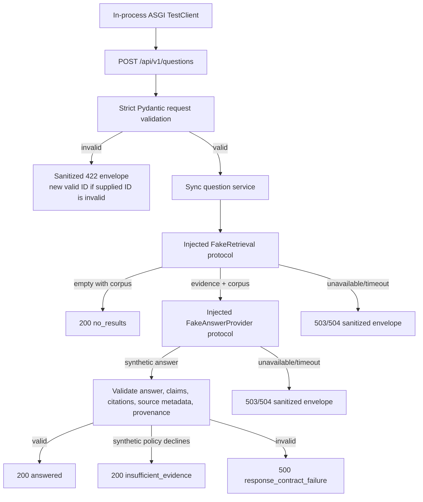

# Implementation Plan: Fake-Only Backend Question API

**Branch**: `011-fake-backend-api` | **Date**: 2026-11-21 | **Spec**: [spec.md](spec.md)

**Status**: Approved for Feature 011 scope by Person 3 on 2026-11-21; T001 authorized.

## Summary

Under the approval recorded below, prepare the
smallest Person 3 API slice: a synchronous, non-streaming
`POST /api/v1/questions` endpoint for `research_question`. The endpoint will
validate a closed Pydantic request, orchestrate independently injected
deterministic fake retrieval and answer-generation dependencies, validate
response-local evidence citations and corpus provenance, and return only the
approved versioned success or sanitized error envelopes defined in
[spec.md](spec.md).

The first implementation will use no database connection, private Person 2
retrieval core, external network call, credential, real provider, live query
embedding, or listening server. This plan does not select or enable
`retrieval.v2`, change Person 1/Person 2 source, or claim scientific answer
quality.

## Planning Scope and Artifact Boundary

This plan follows the architecture, dependency, module-boundary, data-contract,
failure, test, risk, and integration requirements in
[`docs/DEVELOPMENT_WORKFLOW.md`, Stage C](../../docs/DEVELOPMENT_WORKFLOW.md).
The official generic Spec Kit planner can also create data-model, contract, and
quickstart artifacts. The approved feature artifacts are `spec.md`, this
`plan.md`, and `tasks.md`; the HTTP contract is documented in [spec.md](spec.md).
This approval record changes no implementation, tests, dependencies, or shared
retrieval contract.

## Technical Context

| Item | Approved decision |
| --- | --- |
| Language/runtime | Python `>=3.12,<3.13`, already declared in [pyproject.toml](../../pyproject.toml). |
| Project type | Additive internal web-service package under the existing single Python project. |
| Runtime dependencies | `fastapi>=0.115,<1` and `pydantic>=2.7,<3`; lock resolution is T001 work. |
| Test dependency | `httpx>=0.27,<0.29` in the development group for the in-process `TestClient`; lock resolution and import check are T001 work. |
| Storage | None in this feature. Fakes contain synthetic fixture data only. |
| Execution model | One synchronous route/service path. The existing database and private retrieval core are synchronous, but are deliberately not called. |
| Test framework | Existing `pytest` configuration (`tests` test path, `src` Python path) with future focused backend tests. |
| Performance target | No production throughput or latency claim. Offline tests check deterministic bounded fixtures only. |
| External operation boundary | No outgoing network, database connection, provider call, query embedding, listening server, Docker, or protected-evaluation access. |

The existing database session constructs a synchronous SQLAlchemy engine
([`src/sciscope/database/session.py`](../../src/sciscope/database/session.py)).
The present retrieval implementation is explicitly private (`_RetrievalCore`)
and performs synchronous retrieval ([`src/sciscope/retrieval/_core.py`](../../src/sciscope/retrieval/_core.py)); it is not a dependency of this feature.

## Dependency Research and Selection

### Verified external facts

External documentation was consulted only for dependency planning; no package,
lockfile, or environment was fetched or changed.

| Candidate | Verified fact | Plan consequence |
| --- | --- | --- |
| FastAPI | PyPI currently declares MIT and Python `>=3.11`, including a Python 3.12 classifier; it depends on Pydantic and Starlette. [PyPI](https://pypi.org/project/fastapi/) |
| Pydantic | PyPI currently declares MIT and Python `>=3.10`, including Python 3.12. [PyPI](https://pypi.org/project/pydantic/) |
| Test client | FastAPI documents `fastapi.testclient.TestClient`, backed by Starlette and HTTPX, for normal synchronous pytest tests. [FastAPI testing guide](https://fastapi.tiangolo.com/tutorial/testing/) |
| Sanitized validation mapping | FastAPI documents overriding `RequestValidationError` through an exception handler; its examples show the error object can include raw request information, which this feature must not return or log. [FastAPI error handling guide](https://fastapi.tiangolo.com/tutorial/handling-errors/) |

These current metadata facts make the approved dependency direction compatible
with the repository's Python 3.12 range in principle. They do **not** verify a
specific three-package resolver result, Windows wheel availability for the
eventual chosen pins, security posture, or compatibility with the repository's
current lock graph.

### Approved dependency constraints

1. Add FastAPI as an explicit direct runtime dependency.
2. Add Pydantic as an explicit direct runtime dependency because the project
   will define its request/response models directly; do not rely on a
   transitive lock entry.
3. Add HTTPX as an explicit test/development dependency; do not rely on an
   unrelated transitive dependency for the documented in-process test client.
4. During T001, resolve the approved bounded constraints with the approved
   toolchain, inspect the resulting dependency graph/license data, and confirm
   the test-client API at the resolved versions before completing the task.

The FastAPI, Pydantic, and HTTPX constraint ranges are approved. Exact locked
versions and compatibility of the resolved test-client stack remain to be
verified during T001.

## Constitution Check

| Gate | Status |
| --- | --- |
| Research, specification, clarification, plan before implementation | Satisfied as artifacts and explicitly approved for Feature 011 on 2026-11-21. |
| Test-first delivery | Future work begins with failing behavior tests, then minimal implementation, then declared checks. |
| Shared-contract review | The user reports prior TEAM agreement on relevant Phase 1 decisions. P1-11/P1-14 gates are satisfied for this fake-only feature scope. Broader backlog completion remains unverified and unchecked; no retrieval contract is adopted. |
| Owner boundaries | Person 3 owns this API/fake-provider feature. Person 2 and Person 4 delegated Backend & AI technical decisions to Person 3. No Person 2 source or private core is changed/imported. |
| Security/provenance | Fakes only, explicit mock/test metadata, separate corpus provenance, no secrets/live calls/protected data. |
| Evidence/backlog | No tasks are complete. After approved implementation and human verification, update `EVIDENCE.md` and `PROJECT_TODO.md` truthfully. |

The governing constitution remains draft and unratified
([`.specify/memory/constitution.md`, Governance](../../.specify/memory/constitution.md)); its approval gates still apply.

## Proposed Project Structure

The repository currently has `src/sciscope/` packages and feature-organized
`tests/` directories. No existing FastAPI package or backend test area exists.
The proposed additions keep HTTP concerns separate from application protocols.

```text
src/sciscope/
├── api/
│   ├── __init__.py
│   ├── app.py                 # create_app and exception-handler registration
│   ├── http_models.py         # Pydantic request/success/error schemas only
│   └── routes.py              # one POST /api/v1/questions adapter
└── question_service/
    ├── __init__.py
    ├── contracts.py           # plain typed request/outcome/evidence/protocols
    ├── service.py             # synchronous orchestration and outcome mapping
    ├── validation.py          # output/citation/provenance validation
    ├── ids.py                 # request-ID validation and opaque-ID seam
    └── fakes.py               # deterministic synthetic retrieval/provider fixtures

tests/backend/
├── conftest.py                # app factory plus independent fake fixtures
├── test_question_api.py       # HTTP schema/state/error acceptance behavior
├── test_question_service.py   # protocol and fail-closed behavior
└── test_response_validation.py # citation/provenance/output validation oracles
```

`question_service/contracts.py` must have no FastAPI or Pydantic request/
response imports. `api/http_models.py` maps the public HTTP shape to and from
those plain typed values. `api/app.py` owns dependency wiring and exception
translation, so the route can remain a thin adapter. The exact file split may
be simplified during approved implementation only if all listed boundaries and
tests remain clear; broad refactoring is out of scope.

## Architecture and Data Flow



All arrows after request parsing use plain service contracts. The app factory
receives fake dependencies explicitly; no import or configuration lookup may
silently create a database engine, `_RetrievalCore`, Gemini client, embedder,
or network client.

## Data Contracts and Validation Design

### HTTP models

`api/http_models.py` will model the approved public shape in [spec.md](spec.md):

- Closed `QuestionRequest` object: literal `workflow`, trimmed `question`, and
  optional `request_id`; rejected extra fields and absence/type/length/pattern
  failures result in the common sanitized `422` envelope.
- Discriminated success state: `answered`, `no_results`, or
  `insufficient_evidence`, always containing `api_version`, `request_id`,
  `workflow`, `status`, `answer`, `claims`, `evidence`, `corpus`, and
  `metadata`.
- Error envelope: always containing `api_version`, `request_id`, `error`, and
  `metadata`, with the approved error codes and retryability mapping.
- Mock/test metadata is an explicit structured model with both booleans fixed
  to true for this feature; it is present for every success and error response.

The plan does not add public filter, mode, provider, model, corpus-selection,
or streaming fields.

### Service contracts independent of HTTP

`question_service/contracts.py` will define typed immutable values for a
validated question, evidence, corpus provenance, a claim, fake retrieval
outcome, fake provider outcome, and controlled service failures. It will also
define narrow protocols conceptually equivalent to:

- `RetrievalService.retrieve(question, request_id) -> RetrievalOutcome`
- `AnswerProvider.answer(question, evidence, corpus, request_id) -> ProviderOutcome`
- `RequestIdGenerator.new() -> str`

The final exact method signatures are an implementation detail, but their
inputs/outputs must carry no FastAPI/Pydantic objects. A real Person 2 facade
can later adapt to `RetrievalService` only after a separately agreed public
contract. The API must never import `sciscope.retrieval._core._RetrievalCore`.

### Request ID and input path

1. Generate a valid opaque request ID before parsing enough context to prepare
   any error envelope.
2. When a supplied ID matches `^[A-Za-z0-9._:-]{1,128}$`, use it unchanged.
3. When absent, retain the generated ID.
4. When invalid, retain the generated ID, return `422`, and never echo the
   supplied invalid value as trusted metadata.
5. Transform every framework `RequestValidationError` into the same versioned,
   sanitized `invalid_request` envelope. Do not serialize its raw body,
   `errors()`, representation, or traceback.
6. T004 tests request-ID and framework-validation behavior through an isolated
   test-only ASGI validation adapter. The adapter exercises the sanitized
   validation handler without defining a production question route or invoking
   an unavailable service. T004 does not assert or fabricate a question
   success response; T007 adds the final production route and service wiring.

### Retrieval, provider, and response states

- `FakeRetrieval` owns synthetic evidence fixtures and synthetic corpus
  provenance. Its empty result is valid only when it still includes valid
  provenance; the service maps it to `200 no_results` with empty evidence,
  claims, and answer.
- `FakeRetrieval` may return nonempty synthetic evidence. `FakeAnswerProvider`
  deterministically returns either an answered fixture or a controlled
  insufficient-evidence outcome. The latter preserves retrieval evidence and
  corpus provenance and contains no answer/claims.
- An answered fake provider outcome must have a nonempty answer and at least
  one claim. Every claim must have at least one unique citation `chunk_id`.
- `validation.py` verifies response-local evidence identity, no duplicate
  evidence IDs, citation membership and uniqueness, nonempty required source
  metadata, valid corpus provenance, and state-specific shape. It validates
  identity only, never scientific correctness or entailment.
- All validation failures fail closed: discard the output and emit the
  `500 response_contract_failure` envelope.

### Failure mapping

| Origin | HTTP outcome | Public behavior |
| --- | --- | --- |
| Pydantic/FastAPI request validation | `422 invalid_request` | Transform native validation representation into the stable sanitized envelope. |
| Controlled fake retrieval unavailable | `503 retrieval_unavailable` | Retryable, no dependency internals. |
| Controlled fake provider unavailable | `503 provider_unavailable` | Retryable, no dependency internals. |
| Controlled fake dependency timeout | `504 dependency_timeout` | Retryable, no timing/internal detail. |
| Invalid fake output, citation, source metadata, or corpus provenance | `500 response_contract_failure` | Non-retryable; do not serialize invalid output. |
| Unexpected internal exception | `500 internal_error` | Non-retryable sanitized generic message with valid request ID and mock/test metadata; no internal detail. |

The app factory installs one narrow centralized boundary for unexpected
exceptions. It returns the required versioned error envelope with code
`internal_error`, a fixed sanitized message, `retryable: false`, a valid
request ID, and `is_mock`/`is_test_data` set to true. It must not include
exception text, traceback, request input, or source data and must never convert
an unexpected failure to success. Offline `TestClient` checks run in two
configurations: `raise_server_exceptions=True` must surface the original defect
to tests/developers; a client configured with
`raise_server_exceptions=False` to inspect the public response must receive
only the sanitized envelope. The boundary may format and return the
error, but must not silently suppress observability or misclassify it as a
controlled provider/retrieval failure.

## App Factory and Dependency Injection

`create_app(...)` is the only planned composition root. T002 creates its
minimal skeleton with opaque injectable sentinel dependencies solely to prove
app construction and isolation; those sentinels do not implement or imply a
retrieval/provider contract and are not invoked. T005 introduces the formal
typed retrieval/provider protocols and deterministic fakes. T007 completes the
final question-service and production route wiring. The final app factory:

1. Registers the one question route, sanitized request-validation handler, and
   narrow centralized unexpected-exception boundary after their dependencies
   exist.
2. Stores only the explicitly injected dependencies in application-owned state.
3. Does not read provider credentials, construct a database engine, start a
   background operation, or make an external call during startup or shutdown.
4. Uses the deterministic fakes as the sole first-feature composition.

The final production question route is added in T007. T004 tests framework
validation serialization through a test-only ASGI validation adapter under
`tests/backend/`; it does not add a temporary production route or service
response. Request-ID generation and policy are tested directly and through
invalid-request envelopes. No successful question response is asserted until
T007.

The endpoint uses a synchronous service call. This suits the current fake-only
scope and avoids an unreviewed strategy for offloading the existing synchronous
database layer. A later real integration must separately decide event-loop
blocking and lifecycle behavior.

## Offline Test Strategy

### Test isolation

Future tests use `fastapi.testclient.TestClient` against an app from
`create_app` with explicit fakes. The client dispatches to the ASGI app in
process; no server bind/listen command is started. Fixtures must be synthetic,
small, and owned by `tests/backend/` or a clearly named fake-fixture module;
they cannot contain real article prose, protected questions, secrets, or a
database URL.

The fakes have independent controls for: evidence/nonempty vs empty retrieval;
answered vs insufficient-evidence provider output; provider/retrieval
unavailability; simulated timeout; and every output-contract violation. They
must not import network, database, embedding, or live-provider adapters.

### RED then GREEN sequence

With specification and plan approval recorded above, the workflow is:

1. Add focused failing behavior tests for the versioned schema, one endpoint,
   strict validation/invalid-ID generation, and every success state.
2. Add failing fake-protocol and output-validator tests for citations,
   duplicates, source metadata, corpus provenance (including empty result),
   and fake failure mappings.
3. Demonstrate the relevant tests fail for missing behavior before adding the
   minimal app factory/service/fake implementations.
4. Implement in small dependency order until each prior red test passes.
5. Run the approved focused and repository quality checks; record actual
   commands, outcomes, and human verification only after they occur.

This approval-record change creates no test or code.

### Planned verification categories

- HTTP contract: path/method; all required fields; no extras; valid/omitted/
  invalid request ID behavior; framework `422` translation; no raw input in
  errors.
- Success states: deterministic `answered` with at least one cited claim;
  `no_results` retaining corpus provenance with no evidence; and
  `insufficient_evidence` retaining evidence/provenance but no answer/claims.
- Output security: empty/invalid answer; missing/duplicate/non-member
  citations; duplicate chunk IDs; missing/blank source metadata; and missing/
  blank corpus fields all map fail-closed to `500`.
- Controlled failures: retrieval/provider unavailable (`503`) and simulated
  timeout (`504`) retain required metadata and sanitized messages.
- Isolation: fakes record no database/network/provider invocation; tests only
  use the in-process ASGI client.
- Quality: during implementation, the relevant `pytest`, Ruff, formatting, and mypy
  commands from repository workflow are run, with outcomes recorded rather
  than presumed.

## Requirement-to-Component Mapping

| Requirement | Planned component(s) / proof |
| --- | --- |
| FR-001 | `api/routes.py`, app factory; one synchronous `POST /api/v1/questions` contract test. |
| FR-002 | `http_models.py` closed request model; unknown-field/filter/workflow negative tests. |
| FR-003 | `http_models.py`, validation exception handler; strict-input and sanitized-422 tests. |
| FR-004 | `ids.py`, app exception path; valid, omitted, and invalid-ID tests. |
| FR-005 | `http_models.py`, `service.py`; all three success-state contract tests. |
| FR-006 | `contracts.py`, `fakes.py`, `app.py`; injected-fake and no-live-dependency tests. |
| FR-007 | `fakes.py`, metadata model; repeatable fixture and mock-marker tests. |
| FR-008 | `contracts.py`, `validation.py`, response models; source-field/unique-chunk tests. |
| FR-009 | `contracts.py`, `validation.py`, fakes; corpus-separation and empty-result-provenance tests. |
| FR-010 | `validation.py`, `service.py`; answered-claim, citation membership/uniqueness, and fail-closed tests. |
| FR-011 | `service.py`; distinct empty vs synthetic-insufficient tests with no literature-absence language. |
| FR-012 | `app.py`, controlled service failures; 422/500/503/504 envelope tests. |
| FR-013 | `validation.py`, `service.py`; invalid fake output is discarded test. |
| FR-014 | `contracts.py`, dependency wiring; import-boundary review showing no `_RetrievalCore`. |
| FR-015 | app factory/fakes/tests; no connection/client construction and in-process-client isolation tests. |
| FR-016 | route/app configuration review and tests: no streaming/auth/rate/deployment paths. |
| FR-017 | module-boundary review: no retrieval-version selector or v2 adapter. |
| FR-018 | fixture content/review; no real-answer or scientific-quality assertion. |
| NFR-001 | synthetic fakes plus offline test fixture ownership. |
| NFR-002 | Pydantic response models and exhaustive required-field assertions. |
| NFR-003 | sanitized error mapper and negative assertions against raw input/internal data. |
| NFR-004 | `TestClient` tests with no listener, database, container, or external service. |
| SC-001 / SC-005 | test inventory and isolation assertions demonstrate only synthetic offline inputs. |
| SC-002 | negative-test matrix covers declared validation/dependency/contract categories. |
| SC-003 | exact citation-to-evidence oracle and required provenance/source-field checks. |
| SC-004 | parameterized success/error assertions for request ID and mock/test metadata. |

## Risks and Unresolved Decisions

| Risk or decision | Impact | Required resolution / mitigation |
| --- | --- | --- |
| HTTP contract scope | Feature 011's contract is approved for its fake-only scope; this does not define real retrieval integration. | Keep implementation within the approved interface; make a separate decision for real retrieval contracts. |
| No public Person 2 facade | Real retrieval integration could couple API code to `_RetrievalCore`. | Keep fakes behind independent protocols; Person 2 and Person 3 agree a public facade before P4-09. |
| Dependency resolution unverified | Resolver or test-client mismatch could block implementation. | Use the approved ranges below and validate the Python 3.12 lock graph and imports during T001. If incompatible, pause for approval of revised ranges. |
| Generated invalid-request correlation ID | Framework validation occurs before normal request-model handling. | Design exception handler/middleware seam in approved implementation and test it explicitly. |
| Overbroad exception mapping | Could hide errors or leak details. | Map only declared failures; test sanitized output and let unclassified defects fail visibly in tests for review. |
| Synthetic provenance mistaken for real provenance | Could mislead a frontend or later consumer. | Require immutable mock/test metadata and synthetic fixture IDs in every response. |
| Citation identity mistaken for entailment | Could overstate scientific support. | Keep validation limited to response-local identity and preserve FR-018/non-claim language. |

## Owner and Approval Gates

- **Person 3**: owns the planned API, fake protocols, deterministic fixtures,
  output validation, and offline tests under the approved scope.
- **Person 2**: delegated Backend & AI technical decisions to Person 3 and
  reviews any future public retrieval facade/provenance mapping; this feature
  makes no retrieval source change.
- **Person 4**: delegated Backend & AI technical decisions to Person 3; that
  delegation is authority and is not represented as a separate Person 4
  contract signature.
- **TEAM/human gate**: the user reports that the TEAM previously agreed on the
  relevant shared Phase 1 architecture decisions. Person 3 explicitly approved
  this specification, plan, HTTP contract, checklist dispositions, and
  dependency ranges on 2026-11-21 under delegated Backend & AI authority. This
  satisfies the P1-11/P1-14 gates for Feature 011's fake-only scope.
- **T001 authorization**: Person 3 explicitly authorized T001 on 2026-11-21
  once this approval record is committed. T001 remains unstarted and incomplete
  until its dependency changes and verification are performed and recorded.

Relevant backlog items remain open: P4-01–P4-08, P4-13–P4-15, P4-17, P4-20,
P4-21, and P5-05 ([`PROJECT_TODO.md`, Phases 1, 4, and 5](../../PROJECT_TODO.md)).
No backlog task is completed by this approval.

## Formal Analysis and Approval Status

- **Formal speckit-analyze**: **COMPLETED** — formal `speckit-analyze` executed
  successfully on Ubuntu using PowerShell 7.7.0. Its no-persist formal
  prerequisite exited `0` and resolved this Feature 011 directory.
- The formal analysis found no critical or high-severity contradictions. All
  required FR, NFR, and SC items have planned coverage across T001–T008.
- Approval scope, artifact revision, contract decision, checklist dispositions,
  dependencies, and T001 authorization are recorded in the next section.
- The user-reported TEAM decision and feature-scoped P1-11/P1-14 gate status do
  not complete the broader backlog tasks. All `PROJECT_TODO.md` Phase 1
  checkboxes remain unchanged.
- CHK001, CHK003, CHK008, CHK016, and CHK015 remain unchecked. No checklist
  marker is changed by this approval record.

## Approval Record

- **Approver and date**: Person 3 explicitly approved in the current session on
  2026-11-21, acting under Backend & AI technical authority delegated by the
  TEAM.
- **Owner delegation**: Person 2 and Person 4 delegated Backend & AI technical
  decisions to Person 3. This records decision authority, not separate
  individual endorsements of each contract detail.
- **Approved artifacts**: `spec.md` and this `plan.md` as present at repository
  revision `4309b22becef529940f86068329b01a6a5e862f9`.
- **HTTP contract**: Person 3 adopted the proposed `POST /api/v1/questions`
  contract without amendments. It is approved only for Feature 011's fake-only
  scope.
- **TEAM/shared-contract gates**: The user reports that the TEAM previously
  agreed on relevant shared Phase 1 architecture decisions. No individual
  votes or historical date are asserted. This agreement, together with Person
  3's delegated technical authority and explicit approval, satisfies P1-11 and
  P1-14 for this feature's fake-only scope. It does not complete those broader
  backlog tasks or assert that P1-01 through P1-13 are complete.
- **Checklist decisions**: Person 3 accepted the documented feature-specific
  exceptions for CHK001, CHK003, CHK008, and CHK016. Those criteria remain
  unchecked. CHK015 is deferred to implementation verification and remains
  unchecked.
- **Dependency constraints**: Person 3 approved `fastapi>=0.115,<1`,
  `pydantic>=2.7,<3`, and `httpx>=0.27,<0.29`. Lock resolution and compatibility
  checks remain T001 work.
- **T001 authorization**: Person 3 authorized T001 after this record is
  committed. T001 has not started and is not complete. T002–T008 remain
  unstarted and must follow the approved task sequence.
- **Scope limits**: No live provider, outgoing network call, database, real
  retrieval, `_RetrievalCore`, `retrieval.v1` adoption, or `retrieval.v2`
  enablement is authorized by this record.

## Post-Approval Verification and Evidence

The future task plan must keep at most eight reviewable tasks
([`docs/DEVELOPMENT_WORKFLOW.md`, feature size and Stage D](../../docs/DEVELOPMENT_WORKFLOW.md)).
It must name the exact RED test for each implementation increment and the
focused verification commands. Only after actual execution and required human
verification may it update `EVIDENCE.md` and `PROJECT_TODO.md`.

This approval authorizes T001 only. T001 may prepare the approved dependency
environment and run its specified dependency checks. T002–T008 remain gated by
the task sequence. This approval does not authorize a server, database access,
live provider calls, or real retrieval integration.
