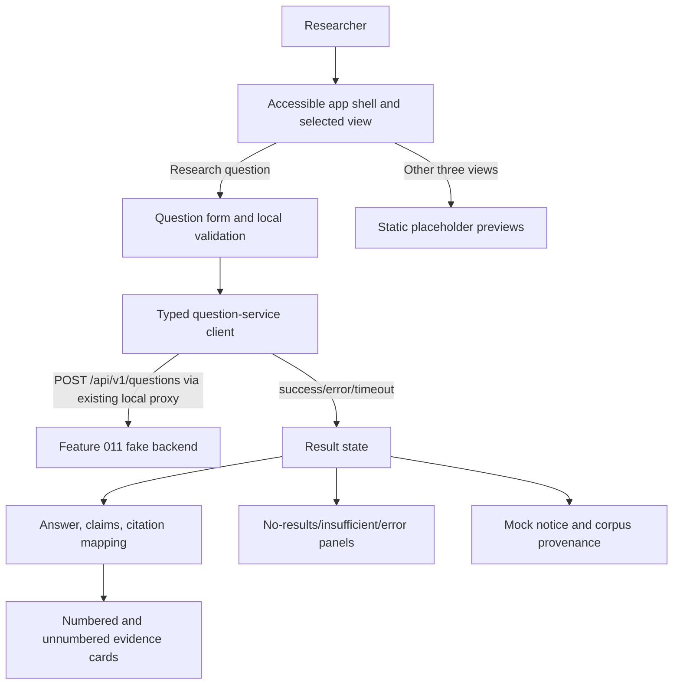

# Implementation Plan: Frontend Research Question Explorer

**Branch**: `012-frontend-explorer` | **Date**: 2026-11-22 | **Spec**: [spec.md](spec.md)

**Status**: Plan and generated task list approved by the project owner on 2026-11-22. Implementation is authorized through T007, with the Explorer demo gate required before T008.

## Summary

Build the Person 4 React/TypeScript frontend slice for the approved fake-only question-service contract. The working Research Question Explorer will validate and submit questions, present every accepted response/error state, resolve citations against response-local evidence, expose provenance, and clearly label synthetic data. The other three workflows are static placeholder previews. Use app state for navigation, a small typed service client, and user-facing component tests with mocked network responses.

No backend, Python, retrieval, database, real-provider, or Python workflow changes are in scope. The local fake server command is documented only as the owner-provided demo procedure; the integration handoff does not make it an officially supported launcher.

## Planning Scope and Artifact Boundary

This plan follows the architecture, dependency, module-boundary, data-contract, failure, test, risk, and integration requirements in [`docs/DEVELOPMENT_WORKFLOW.md`](../../docs/DEVELOPMENT_WORKFLOW.md). It covers frontend application files, frontend documentation, and the Feature 012 spec artifacts, plus truthful status/evidence updates in `PROJECT_TODO.md` and `EVIDENCE.md`.

The user approved the specification with three corrections: result-scoped mock-notice dismissal, metadata-driven header badge visibility, and a 30-second abortable retryable timeout with exact message. The owner then approved this plan, including the ESLint and `@eslint/js` v9 alignment, and approved the generated task list. Implementation is authorized through T007; T008 remains gated on the Explorer demo walkthrough.

## Technical Context

| Item | Proposed decision |
| --- | --- |
| Language/runtime | TypeScript with React 19; Node.js `v24.20.0` is owner-reported. It exceeds Vite's documented Node minimum (20.19+ or 22.12+) and Vitest 5's minimum (22.12+). |
| Existing build/dev dependencies | React `^19.3.1`, React DOM `^19.3.1`, Vite `^8.3.6`, React Vite plugin, TypeScript `~6.0.3`, ESLint `^10.14.0`. The frontend currently uses npm and has a package lock. |
| Proposed added runtime dependencies | `@fontsource/ibm-plex-sans` and `@fontsource/ibm-plex-mono` for locally bundled fonts, as required by the spec. No UI component library or router. |
| Proposed added development dependencies | Vitest 5, `@testing-library/react`, `@testing-library/user-event` v14, `jsdom`, and `eslint-plugin-jsx-a11y` 6.10.2. Exact resolved versions and licenses for packages whose npm pages returned 403 remain to be checked during approved dependency work. |
| ESLint compatibility adjustment | The current ESLint 10 declaration conflicts with `eslint-plugin-jsx-a11y` 6.10.2, whose published peer range ends at ESLint 9. The approved change aligns both `eslint` and `@eslint/js` to compatible v9 releases and applies `flatConfigs.recommended`, without bypassing peer-dependency validation. |
| Storage | No user data persistence. Mock-notice dismissal exists only for the currently displayed response and resets when a new response arrives. No saved searches or hypotheses. |
| Testing | Vitest with jsdom, React Testing Library, user-event, and mocked `fetch`; no automated test contacts the backend. |
| Target platform | Modern desktop and mobile browsers; the UI must remain usable at 390 px viewport width. |
| Project type | Existing single-project web frontend in `frontend/`. |
| Performance/timeout | One non-streaming request at a time; abort a pending request at 30 seconds and show the approved retryable timeout message. No production throughput or backend latency claim. |
| Constraints | Stay in `frontend/` and Feature 012 docs plus `PROJECT_TODO.md` and `EVIDENCE.md`. Keep Python and backend files untouched, do not add CORS, do not call paid/live AI, and do not change the Python workflow. |
| Scope | One connected research-question workflow and three static previews; no filter controls, saved behavior, real retrieval, live provider, or scientific-quality claim. |

### Runtime compatibility check

The project owner supplied Node.js `v24.20.0`, and the local `node --version` command returned `v24.20.0`. Current official Vite documentation requires Node `20.19+` or `22.12+`, and current Vitest 5 documentation requires Node `22.12+` and Vite `6.4+`. Therefore the installed Node version satisfies both requirements, and the frontend's installed Vite `8.3.8` satisfies Vitest's Vite minimum. Sources: [Vite Getting Started](https://vite.dev/guide/), [Vitest Getting Started](https://vitest.dev/guide/), and [Vitest 5 migration guide](https://vitest.dev/guide/migration/).

## Dependency Research and Selection

### Verified facts

| Candidate | Verified fact | Plan consequence |
| --- | --- | --- |
| In-app state vs router | React documents lifting shared state to a common parent. The feature has four sections but no URL/deep-link requirement. [React state guidance](https://react.dev/learn/sharing-state-between-components) | Use one selected-view state; omit `react-router-dom`. |
| Vitest vs Jest | Vitest is powered by Vite and reads the Vite configuration by default. Its current v5 documentation requires Vite >=6.4 and Node >=22.12. [Vitest guide](https://vitest.dev/guide/) | Use Vitest v5, which fits the existing Vite 8 and supplied Node 24.20. |
| Component behavior tests | React Testing Library supports multiple runners and tests through rendered DOM. user-event v14 simulates browser-like interactions. [RTL](https://testing-library.com/docs/react-testing-library/intro/), [user-event](https://testing-library.com/docs/user-event/intro/) | Test user-visible states and keyboard interactions; use Vitest mocks for `fetch`. |
| JSX accessibility linting | `eslint-plugin-jsx-a11y` 6.10.2 is MIT and exposes `flatConfigs.recommended`; its peer dependency range is ESLint 3 through 9. The repository's current ESLint 10 is outside that range. The official ESLint 10 support issue remains open. [Package metadata](https://github.com/jsx-eslint/eslint-plugin-jsx-a11y/blob/main/package.json), [README](https://github.com/jsx-eslint/eslint-plugin-jsx-a11y), [support issue](https://github.com/jsx-eslint/eslint-plugin-jsx-a11y/issues/1075) | Propose aligning ESLint and `@eslint/js` to v9 before adding the recommended preset. Confirm the complete frontend lint dependency graph during dependency resolution. |
| IBM Plex fonts | The user requires IBM Plex Sans and IBM Plex Mono to be bundled locally using Fontsource packages for offline demo operation. Registry pages could not be fetched during research. | Use the requested packages; verify package license, current versions, and offline bundling when dependency changes are approved. |

### Decisions and alternatives

1. **Navigation**: use simple state-driven navigation. A router would add a package and URL behavior that has no acceptance requirement.
2. **Testing**: use Vitest, jsdom, React Testing Library, and user-event. Jest is feasible but would duplicate runner/transform configuration in the Vite project.
3. **Accessibility linting**: use the requested JSX accessibility plugin and recommended flat preset after aligning the frontend ESLint core/config major to 9. Keeping ESLint 10 while ignoring the peer range is rejected because the package does not declare compatibility and package installation could fail or create an unsupported stack.
4. **Optional browser E2E**: do not add Playwright in this scope. A later plan/task may propose a browser-driven smoke test only if the user approves the extra dependency. Component tests remain offline and deterministic.
5. **Frontend CI**: propose a separate frontend CI job to the team; do not edit the existing Python workflow as part of Feature 012.

Registry limitations: npm pages for Vitest, Testing Library, jsdom, and Fontsource packages returned HTTP 403 during research. Their exact current versions/license metadata and the final compatible ESLint lock resolution must be verified during approved dependency work before installation is considered complete.

## Constitution Check

| Gate | Status at plan draft |
| --- | --- |
| Research, specification, and explicit approvals | Research completed; specification and plan approved by the project owner on 2026-11-22 with the requested corrections applied. The generated task list is approved; implementation is authorized through T007, subject to the Explorer demo gate before T008. |
| Test-first delivery | The approved task list requires behavior tests to demonstrate RED before implementation, followed by small sequential tasks. The owner approved implementation through T007 on 2026-11-22. |
| Shared contracts | Use only the accepted Feature 011 contract as documented in the Person 3 handoff. No shared contract or backend source changes. Report missing fields and future integration needs to Person 3. |
| Owner boundaries | Person 4 owns all planned source and documentation changes. No Python, database, retrieval, or Person 3 backend files are in the file scope. |
| Security and provenance | No credentials, paid AI, live providers, or live backend in automated tests. Synthetic data remains conspicuously labeled; citations resolve only to response-local evidence. DOI links use safe new-tab behavior. |
| Reviewable delivery | Limit changes to frontend, Feature 012 artifacts, `PROJECT_TODO.md`, and `EVIDENCE.md`. No commits, pushes, or Python workflow edits. |
| Evidence and task state | Record exact checks and failures honestly. Keep backlog items unchecked until automated checks pass and the feature owner confirms manual verification. |

No constitution violation is identified. The project constitution is a draft, but its approval, security, ownership, and verification gates still apply.

## Architecture and Boundaries

### Application flow



### Component responsibilities

- **App shell**: owns selected section and the latest question result; renders header, navigation, global mock badge, content region, and footer.
- **Question form**: owns editable question text, character count, inline validation, example-fill actions, submit-disabled state, and request generation.
- **Question client**: builds only the accepted request shape, calls the same-origin `/api/v1/questions` path, parses success/error envelopes, and translates network, proxy, malformed-response, and abort/timeout cases to a safe client error union.
- **Result views**: render answered, no-results, insufficient-evidence, loading, or error state from typed data. Error copy is selected from the known error code; raw backend message/body is not rendered.
- **Citation resolver**: pure function that walks claims in order, assigns a source number on first known citation, ignores unknown source IDs, de-duplicates repeated IDs, and returns uncited evidence separately. It does not infer links from passage text or DOI.
- **Source card and citation marker**: citation activation scrolls to the matching card and applies a temporary visual highlight. Source location stays in disclosure; DOI is a safe external link.
- **Mock notice**: response-scoped dismissal state resets for each new response. Header badge starts visible; latest response metadata keeps it visible if either marker is true, and hides it only if both are explicitly false.
- **Preview views**: static placeholders only, with navigation state and clear preview banners. No backend request or invented scientific result.

### Request lifecycle and timeout

1. Validate the trimmed question length from 1 through 2,000 before enabling submission.
2. Generate a request ID matching the handoff's accepted pattern and include it with the fixed workflow and trimmed question.
3. Start one request with an abort signal and a 30-second timer. Disable repeat submission and show the accessible loading state.
4. On response, cancel the timer, parse the typed response, update the header badge from the latest response metadata, and reset current-result notice dismissal.
5. On local 30-second timeout, abort the request and create a retryable client error with exact text “The request took too long. Please try again.” Preserve the generated request ID as the reference and keep the question editable.
6. On fetch rejection, show the approved reachability message and retry affordance.
7. For HTTP 5xx, parse the body first. If it is a valid API error envelope, map it by error code and honor its retryable flag. If it is not a valid API error envelope (including an HTML proxy page, empty body, malformed JSON, or success-shaped body), classify it as API unreachable and show “Cannot reach the SciScope API. Is the backend running?” with retry. Preserve the generated request ID when no valid envelope provides a response ID.
8. For malformed JSON or a malformed envelope returned with HTTP 200 or 4xx, show a safe generic nonretryable error; do not fabricate a backend code or render response details. A valid error envelope uses its retryable flag and returned request ID.

### Friendly error presentation

| Error case | User message direction | Retry behavior |
| --- | --- | --- |
| `invalid_request` | Ask the user to review the question and request. | No retry button (`retryable` is false). |
| `retrieval_unavailable`, `provider_unavailable` | State the service is temporarily unavailable. | Show “Try again” only when the envelope says retryable. |
| `dependency_timeout` | State a required service timed out. | Show “Try again” only when the envelope says retryable. |
| `response_contract_failure` | State the response could not be validated safely. | No retry button (`retryable` is false). |
| `internal_error` | State an unexpected service error occurred. | No retry button (`retryable` is false). |
| Local 30-second timeout | “The request took too long. Please try again.” | Retryable; abort the in-flight request. |
| Fetch rejection or HTTP 5xx without a valid API error envelope | “Cannot reach the SciScope API. Is the backend running?” | Retryable. |
| Malformed HTTP 200 or 4xx body/envelope | A generic safe response error without backend details. | Nonretryable. |
| Valid API error envelope | Friendly code-mapped message; never display raw envelope text. | Follow the envelope's retryable flag. |

Exact friendly copy for known server codes is a plan-level UI decision; the messages above are approved for this feature. Error code mapping must remain aligned with the handoff.

## Data Model and Contract Design

The detailed UI data model is in [data-model.md](data-model.md), and the request/response interface mirror is in [contracts/question-service.md](contracts/question-service.md). The backend handoff remains authoritative; these artifacts do not amend the backend contract.

Key constraints:

- Submit only `workflow`, trimmed `question`, and valid `request_id`; no filters, provider or model choice, mode, or unknown fields.
- Use the fixed API path through the existing Vite proxy; do not add backend CORS or direct database/retrieval access.
- Model all three success outcomes as distinct discriminated states.
- Model API error responses separately from network, timeout, and malformed-response failures.
- Treat mock/test-data markers as booleans for UI visibility. Feature 011 currently reports both true on every response; a future response with both false is the only condition that hides the header badge.
- Resolve citations by joining the response-local claim references to response-local evidence identifiers. Never show author/year/section fields absent from the current contract.
- Keep corpus provenance separate from evidence identity and display all three reported provenance values in a disclosure.

## Accessibility, Visual Design, and Responsive Behavior

- Use semantic header, navigation, main, forms, labels, headings, buttons, links, tables, blockquotes, and details/summary disclosure elements.
- Use `aria-current="page"` for the active view, `aria-live="polite"` for result-state announcements, and `aria-busy` while waiting.
- Ensure all interactions work by keyboard and have visible focus rings; icon-only controls receive accessible names.
- Use the approved palette, IBM Plex fonts, requested type scale, spacing, card and button sizes, high contrast, and reduced-motion behavior from FR-016/FR-017.
- At 390 px width, allow navigation wrapping or horizontal scrolling and wrap long identifiers/DOIs/passages so the page does not overflow.
- Use no UI library, gradients, emoji, or decorative animation.
- Add the plugin's recommended flat accessibility rules only after ESLint 9 alignment is resolved; still do manual keyboard and contrast verification because static linting is incomplete.

## Proposed Project Structure

```text
frontend/
  README.md
  package.json
  package-lock.json
  eslint.config.js
  vite.config.ts                 # preserve existing /api proxy
  src/
    api/
      types.ts                   # exact question request/success/error types
      client.ts                  # typed fetch, timeout, network and parse failures
      fixtures.ts                # typed fake response fixtures for offline tests
    lib/
      citations.ts               # pure citation-numbering function
      requestId.ts               # valid request ID generation
    components/
      Header.tsx
      Navigation.tsx
      MockNotice.tsx
      SourceCard.tsx
      CitationMarker.tsx
      StatusPanel.tsx
      Skeleton.tsx
    features/
      explorer/
        ExplorerPage.tsx
        QuestionForm.tsx
        AnswerView.tsx
      previews/
        ComparisonPreview.tsx
        ConflictsPreview.tsx
        GapsPreview.tsx
    styles/
      tokens.css
      global.css
    test/
      setup.ts
    **/*.test.ts(x)              # pure, client, and component behavior tests
  index.html

specs/012-frontend-explorer/
  spec.md
  research.md
  plan.md
  data-model.md
  quickstart.md
  contracts/question-service.md
  checklists/requirements.md
```

File boundaries are implemented sequentially under the approved task list. The existing Vite config and app starter may be edited only inside `frontend/`. Do not delete or commit the pre-existing untracked `frontend/` directory as part of this plan.

## Test and Verification Strategy

All automated behavior tests use local fixtures and mocked `fetch`; no real backend, provider, AI API, or paid call is used.

1. **Pure citation tests**: first-citation order across claims; duplicate references; unknown references ignored; uncited evidence separated; all evidence remains unnumbered when no claim references it.
2. **Request ID tests**: generated IDs match the approved character set and length.
3. **Client tests**: valid answered/no-results/insufficient-evidence parsing; sanitized 422; retryable 503/504; nonretryable 500; fetch rejection; HTTP 5xx with HTML, empty, malformed-JSON, and success-shaped bodies maps to retryable API-unreachable; malformed HTTP 200 and malformed 4xx bodies map to generic nonretryable errors; 30-second abort behavior with a controlled timer; timeout message and request reference.
4. **Form/state tests**: empty/whitespace and >2,000 validation; request while loading; duplicate submit prevention; question retention; examples fill without auto-submit; every response/error state; retry button conditional behavior; badge default/true/false metadata transitions; current-response-only notice dismissal and reset on each new response.
5. **Citation/evidence tests**: citation button accessible name; scroll and highlight target card; numbered and unnumbered grouping; no fabricated author/year/section; DOI URL/target/rel.
6. **Preview/accessibility tests**: each preview's exact headings/labels and placeholders; disabled actions; keyboard-operable controls; active navigation semantics; busy/live announcements; no invented claims.
7. **Static/build checks**: `npm run lint`, `npm run typecheck`, `npm run test`, and `npm run build` inside `frontend/`; verify the lockfile resolves without peer override and fonts are bundled locally.
8. **Manual owner verification**: run the frontend with the user-provided local fake backend modes, inspect answered/no-results/insufficient/error behavior, verify citations, notice/badge transitions, timeout handling, keyboard operation, 390 px layout, and confirm demo labeling. Do not mark tasks complete until the owner reports acceptance.

Playwright/browser E2E is excluded until separately approved. A browser test against the running fake server may be proposed later, but mock-based tests are sufficient for the planned automated suite.

## Implementation Sequence and Demo Gate

Complete the shared test/dependency foundation, then finish User Story 1 (question submission, answered result, citations, and provenance), followed by User Story 2 (empty, insufficient, synthetic, service-error, proxy-unreachable, network, and timeout states). Before any User Story 3 preview-screen task begins, the Explorer must be demo-ready: its README setup/demo commands are present, `npm run lint`, `npm run typecheck`, `npm run test`, and `npm run build` pass in `frontend/`, and its fake-backend flows have been checked. The preview task depends on this gate. Keep preview screens in their own later task group, ending with passing preview tests and frontend checks.

## Frontend CI Proposal (Not Applied)

Propose a separate frontend CI job to the team that runs lockfile-based install, lint, typecheck, unit/component tests, and build on pull requests. The Python workflow is not changed. This proposal does not create or edit any CI workflow in Feature 012.

## Risks and Mitigations

| Risk | Mitigation |
| --- | --- |
| Fake API remains synthetic and is not real literature retrieval. | Default-visible header badge, result-scoped synthetic notice, preview labels, and no scientific claims in placeholder screens. |
| Handoff does not define an official listener/launcher. | Use the owner's provided local command only as a clearly labeled demo procedure; ask Person 3 whether a supported launcher should be specified later. |
| ESLint 10 conflicts with plugin's declared peer range. | Plan proposes coordinated ESLint and `@eslint/js` v9 alignment; verify all package peers and lint under approved implementation tasks. |
| Exact dependency metadata could not be verified online for several packages. | Verify current package versions/licenses and lockfile resolution before treating dependency setup as complete. No install is attempted in planning. |
| Client timeout can race a late response. | Use one per-request abort controller, mark timeout before abort, clear timer on settlement, ignore late completion, and cover race behavior with controlled-timer tests. |
| Stale response could change notice/badge state after a newer query. | Disable duplicate pending requests; tie response state/dismissal to the active request and accept only the current request's completion. |
| Unknown or malformed content could leak raw server details. | Validate response shape and render only typed fields; malformed response maps to generic safe UI copy. |
| Citation IDs can be duplicated or missing from evidence. | Pure deterministic join; deduplicate by first known source ID; ignore unknown IDs; separate all uncited evidence. |
| Small screens or long source strings can overflow. | Constrain width, wrap long content, and verify at 390 px manually and in responsive component/browser checks. |

## Integration Points and Open Follow-ups

- **Person 3 contract review**: No API change is requested. Future contract questions include authors, publication year, section path, request filters, a supported launcher, real retrieval integration (P4-09), and Gemini integration (P4-10).
- **Person 2 retrieval**: No private retrieval import or direct DB access. Person 4 consumes only the accepted Feature 011 HTTP boundary in this feature.
- **Team CI**: Separate frontend job proposal only; review and approval are outside this plan.
- **Feature owner**: Manual verification and explicit acceptance are required after all automated checks.

## Constitution Re-check

| Gate | Design result |
| --- | --- |
| Test-first | PASS — tasks will write behavior tests before implementation and capture RED/GREEN results. |
| Provenance | PASS — response-local IDs and corpus metadata are preserved; fake material is labeled synthetic. |
| Contract safety | PASS — no unsupported request fields, backend changes, or real-provider fallback. |
| Owner boundaries | PASS — frontend implementation stays with Person 4; no Person 3/Person 2 files are modified. |
| Verification/evidence | PASS — check results and manual owner evidence will be recorded; backlog items stay unchecked until acceptance. |

## Approval Gate

The project owner approved this plan and the generated task list on 2026-11-22, including alignment of the frontend ESLint core/config packages to major 9. Implementation is authorized through T007. Do not start T008 until the owner reports the Explorer demo walkthrough result.
